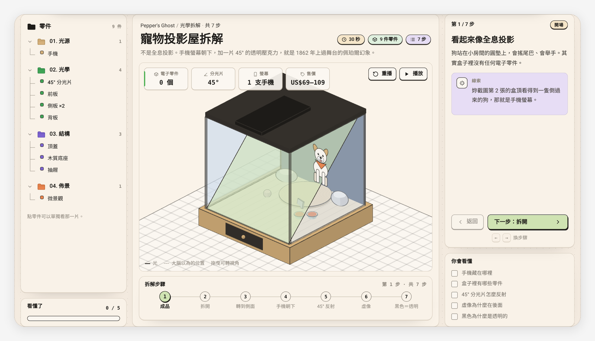
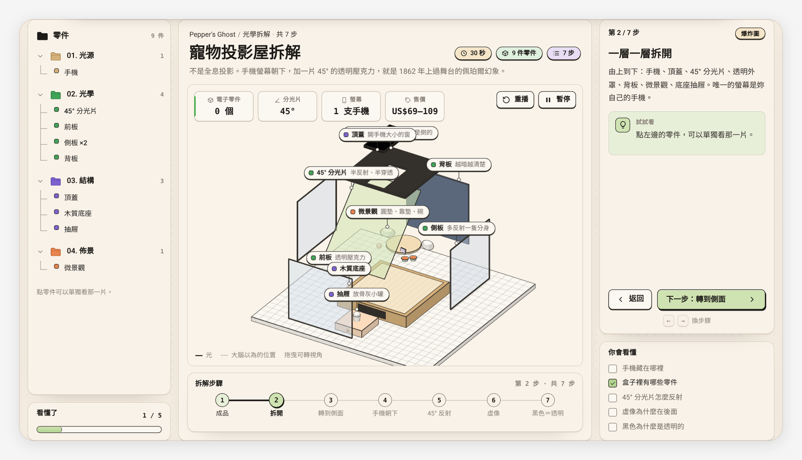
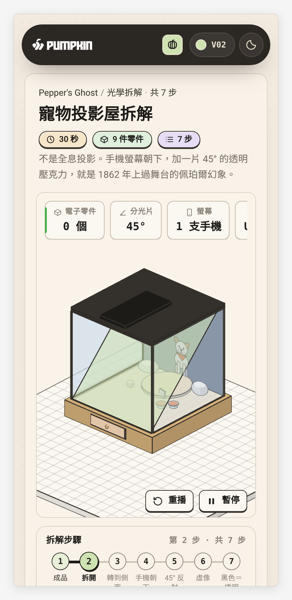
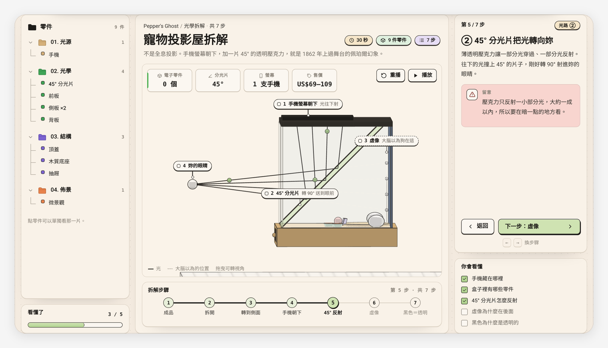
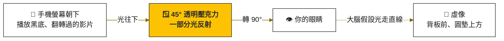
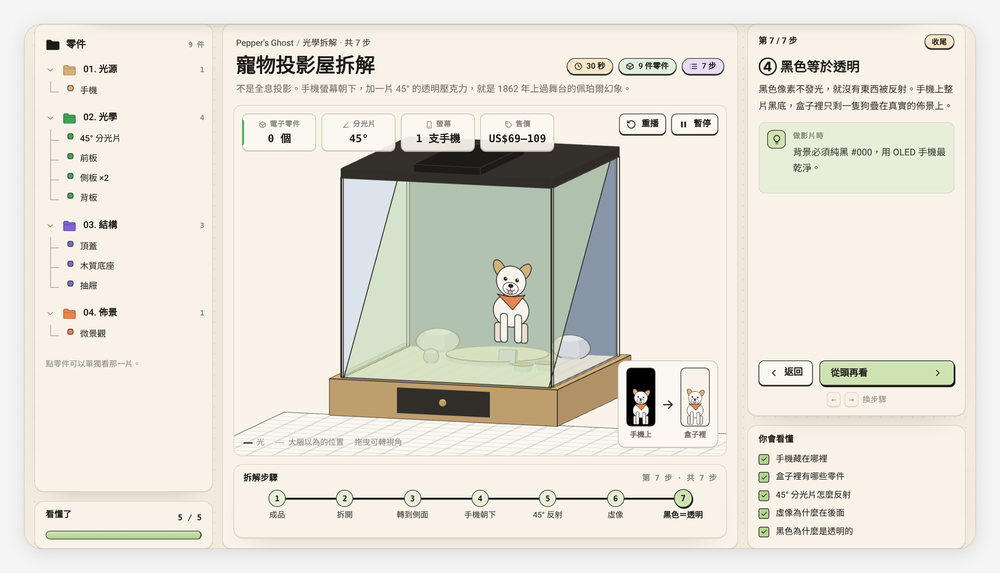
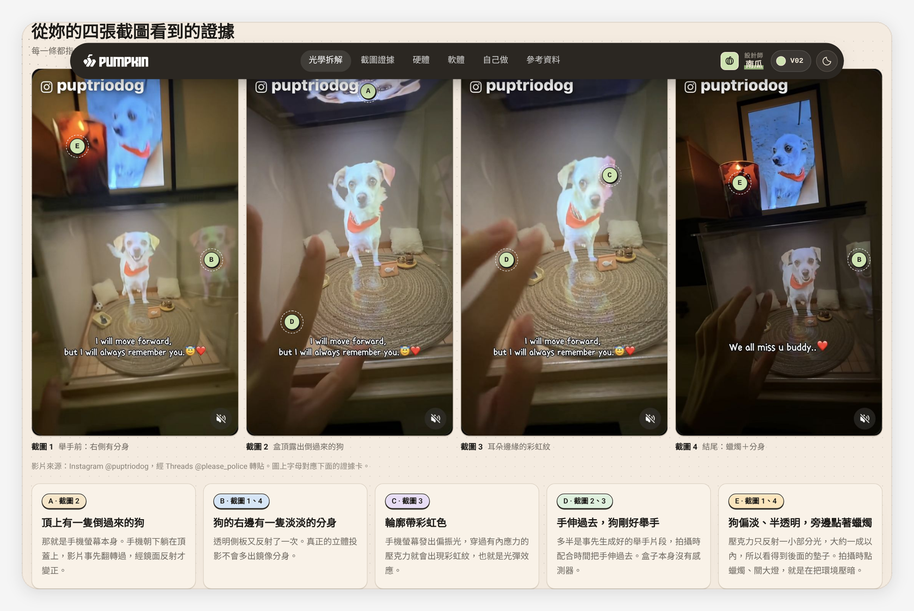
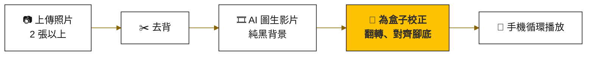

<picture>
  <source media="(prefers-color-scheme: dark)" srcset="assets/banner-dark.svg">
  
</picture>

<h1 align="center">🐶 寵物投影屋拆解</h1>

<p align="center"><b>網路上爆紅的「寵物全息投影屋」，用 3D 爆炸圖一步一步拆給你看</b></p>

<p align="center">
  <a href="https://nanhong-byte.github.io/pumpkin-pet-hologram/"></a>
  
  
  
</p>

<p align="center">
  <a href="#-看起來怎樣">看起來怎樣</a> •
  <a href="#-它到底怎麼做到的">原理</a> •
  <a href="#-從截圖找到的證據">截圖證據</a> •
  <a href="#-硬體盒子裡有什麼">硬體</a> •
  <a href="#-軟體真正的工夫在影片">軟體</a> •
  <a href="#-想自己做一個">自己做</a>
</p>

Threads 上有一支影片很紅：一個小木盒裡站著已經過世的狗狗，會搖尾巴、會舉手，留言區一片「我不行😭」。商品名寫著「全息投影」，很多人以為很高科技。

其實它是 1862 年就上過舞台的光學魔術「佩珀爾幻象」（Pepper's Ghost）：**手機螢幕朝下放在盒頂，一片斜 45° 的透明壓克力把畫面反射到你眼前。** 盒子裡沒有任何電子零件。

這個網頁用一條 30 秒的 3D 動畫，把盒子拆開、切成剖面，讓你親眼看到光怎麼走。看完你會知道它怎麼騙過眼睛，也知道自己做一個要注意什麼。

<p align="center">
  <a href="https://nanhong-byte.github.io/pumpkin-pet-hologram/"><b>👉 打開線上版</b></a> ・ <a href="docs/making-of.md"><b>📖 製作心得</b></a>
</p>

---

## 📌 目錄

- [👀 看起來怎樣](#-看起來怎樣)
- [🧩 它到底怎麼做到的](#-它到底怎麼做到的)
- [🔍 從截圖找到的證據](#-從截圖找到的證據)
- [📦 硬體：盒子裡有什麼](#-硬體盒子裡有什麼)
- [🎬 軟體：真正的工夫在影片](#-軟體真正的工夫在影片)
- [🛠️ 想自己做一個](#️-想自己做一個)
- [💻 這個網頁怎麼做的](#-這個網頁怎麼做的)
- [📚 參考資料](#-參考資料)
- [📖 製作心得：一支讓人哭的影片，我把它拆成 3D 動畫](docs/making-of.md)

---

## 👀 看起來怎樣

網頁分三欄：左邊是零件樹，中間是 3D 舞台，右邊是每一步的說明。動畫會自己播，也可以點下面的步驟條跳到任何一步，或在舞台上拖曳轉視角。

<p align="center"></p>

整段動畫是 7 步，一條時間軸從頭跑到尾：

| 步驟 | 秒數 | 畫面在做什麼 |
|---|---|---|
| 1 成品 | 0–2 秒 | 組好的盒子，狗站在圓墊上 |
| 2 拆開 | 2–12 秒 | 爆炸圖：每個零件依序往外飛，停下來讓你看清楚 |
| 3 轉到側面 | 12–15.5 秒 | 合起來，鏡頭轉到側邊，外罩變透明 |
| 4 手機朝下 | 15.5–18.2 秒 | 光從手機往下射 |
| 5 45° 反射 | 18.2–20.8 秒 | 光撞上分光片，轉 90° 進眼睛 |
| 6 虛像 | 20.8–23.5 秒 | 虛線畫出「大腦以為狗在哪裡」 |
| 7 黑色＝透明 | 23.5–30 秒 | 回到正面，旁邊小卡對照「手機上」和「盒子裡」 |

<p align="center"></p>

> [!TIP]
> 在左邊零件樹點任何一個零件，其他零件會變淡，只留那一片讓你細看。再點一次就恢復。

手機上也能看，三欄會自動疊成一欄：

<p align="center"></p>

---

## 🧩 它到底怎麼做到的

一句話：**你看到的狗是反射出來的，不是投影出來的。**

比喻一下：就像晚上從亮著燈的房間看窗戶，玻璃上同時看得到窗外的街景和房間裡的你。投影屋把「房間裡的你」換成手機上的狗，把「窗外街景」換成盒子裡的小房間。

<p align="center"></p>

光走的路線：



三個關鍵：

1. **45° 剛好把往下的光轉成水平。** 手機在上面，眼睛在前面，中間差 90°，斜放 45° 的鏡面剛好轉過去。
2. **大腦只會假設光走直線。** 反射光看起來像從分光片後面直直射來，所以狗被「放」在背板前面。那裡其實什麼都沒有。
3. **黑色等於透明。** 黑色像素不發光，就沒有東西被反射。手機上整片黑底，盒子裡只剩一隻狗疊在真實的佈景上。

<p align="center"></p>

<details>
<summary><b>🔧 進階：為什麼狗一定站在盒子後段？</b></summary>

虛像到分光片的距離，等於手機到分光片的距離（平面鏡的性質）。

在這個模型裡，分光片是 `y + z = 12` 這個平面，手機螢幕在 `y = 23`。
把螢幕上任一點對分光片做鏡射，會落在 `z = 12 − 23 = −11`，也就是背板前 0.6 公分。

想讓狗的腳剛好踩在墊子上，螢幕畫面「靠前的那一端」要對應到地板高度。所以影片裡狗的腳要貼著畫面一邊，墊子也要往後擺。這也是為什麼實際商品的佈景都集中在後半部。
</details>

---

## 🔍 從截圖找到的證據

這是 Threads 上那支影片的四個畫面（影片來源：Instagram @puptriodog）。圖上的字母對應下面的表。

<p align="center"></p>

| | 在哪裡看到 | 代表什麼 |
|---|---|---|
| **A** | 截圖 2 盒頂 | 有一隻倒過來的狗，那就是朝下的手機螢幕本身 |
| **B** | 截圖 1、4 右側 | 狗旁邊多一隻淡淡的分身，是透明側板又反射了一次。真的立體投影不會有鏡像分身 |
| **C** | 截圖 3 耳朵 | 邊緣有彩虹紋。手機螢幕發出偏振光，穿過有內應力的壓克力就會這樣（光彈效應） |
| **D** | 截圖 2、3 手 | 手伸過去狗剛好舉手。多半是事先生成好的舉手片段，配合時間伸手拍的 |
| **E** | 截圖 1、4 蠟燭 | 狗偏淡、半透明。壓克力只反射一小部分光，點蠟燭、關大燈是在把環境壓暗 |

---

## 📦 硬體：盒子裡有什麼

盒子本身不插電，唯一的光源和影像都來自你自己的手機。

| 零件 | 材質 | 作用 |
|---|---|---|
| 📱 手機 | 自備，OLED 最好 | 光源兼影像。螢幕朝下、亮度開最高。OLED 的黑是真的不發光，背景最乾淨 |
| 🟩 45° 分光片 | 1–2 mm 透明壓克力或 PET 膜 | 整個魔術的核心：一部分光穿透（你看得到佈景），一部分光反射（你看得到狗）。越薄，雙重影像越不明顯 |
| 🔲 前板、側板 | 透明壓克力 | 防塵，讓你從前面看進去。側板會多反射一隻分身 |
| ⬛ 背板 | 深色或霧面 | 背景越暗，狗的對比越高 |
| 🪵 頂蓋 | 木板，開手機大小的窗 | 固定手機，擋住旁邊的雜光 |
| 🪵 底座＋抽屜 | 實木 | 放骨灰小罐或毛髮紀念 |
| 🧸 微景觀 | 圓墊、靠墊、碗、小球 | 給大腦一個真實的空間參考，狗看起來才像站在裡面 |

根據 [Jingsourcing 的拆解](https://jingsourcing.com/fb-pet-memory-box/)，這類商品售價約 69–109 美元，大概是一般寵物骨灰罐的兩到三倍。

---

## 🎬 軟體：真正的工夫在影片

盒子很便宜，讓狗看起來像真的，靠的是這五步：



1. **上傳照片**：通常只要兩張以上清楚的照片，正面、側面各一張。
2. **去背**：用分割模型把狗從背景切出來。
3. **AI 圖生影片**：生成搖尾巴、舉手、歪頭、吃飯等動作片段，背景一律純黑 `#000000`。
4. **為盒子校正**（最容易被忽略）：
   - 鏡像翻轉一次，因為鏡面會再翻回來
   - 腳底對齊畫面靠前的那端，讓狗踩在墊子上
   - 比例符合真實體型
   - 調高亮度，補回反射損失
5. **循環播放**：輸出成無縫循環影片，手機全螢幕播放、關掉自動鎖定。比較高階的版本會用 app 在幾段動作之間切換，做出餵食、摸摸的互動感。

---

## 🛠️ 想自己做一個

四件事決定效果好不好：

| 重點 | 做法 | 做錯會怎樣 |
|---|---|---|
| 角度 | 分光片剛好 45° | 狗往前倒或往後仰 |
| 純黑背景 | 影片背景 `#000`，用 OLED 手機 | 有一點灰，整片壓克力就蒙上一層霧 |
| 環境光 | 盒內和房間都暗一點 | 狗淡到幾乎看不見 |
| 佈景位置 | 佈景往後擺 | 狗浮在半空，沒踩在墊子上 |

> [!WARNING]
> 分光片越厚，前後兩面各反射一次，就會看到兩隻重疊的狗。用 1 mm 以下的壓克力或 PET 膜比較乾淨。

---

## 💻 這個網頁怎麼做的

整個網站就是一個 `index.html`，不用安裝、不用編譯。

### 檔案結構

```
.
├─ index.html        ← 整個網站（CSS、3D、互動都在裡面）
├─ logo.svg          ← 南瓜 Logo
├─ img/              ← 四張影片截圖
├─ assets/           ← 這份 README 用的 Banner 和截圖
└─ .nojekyll         ← 讓 GitHub Pages 直接照原樣發布
```

### 在自己電腦打開

```bash
git clone https://github.com/nanhong-byte/pumpkin-pet-hologram.git
cd pumpkin-pet-hologram
python3 -m http.server 8000
```

打開瀏覽器到 `http://localhost:8000`，看到三欄畫面、動畫自己開始播，就成功了。

<details>
<summary><b>🔧 進階：3D 的畫法</b></summary>

視覺照「南瓜墨金美學 1.9」的 V02 綠意紙本版，3D 照它的 §11 規則：

| 部分 | 做法 |
|---|---|
| 鏡頭 | 正交鏡頭（`OrthographicCamera`），看起來像等角圖 |
| 明暗 | 自訂 shader：頂面＝本色，正面疊墨 12%、側面 20%、底面 26%，不打彩色光 |
| 墨線 | `LineSegments2` 粗線 1.4px；圓形物件用「反向外殼」描輪廓 |
| 配色 | 全部從 CSS 變數讀（`--ig-accent`、`--ig-tint-*`、`--ig-f-*`），切換 V01／V02、深淺色時 3D 跟著換 |
| 時間軸 | 一個 30 秒的時鐘同時驅動零件位移、鏡頭、標籤、光線和步驟條 |
| 光路 | 光線位置用平面鏡公式算，不是手擺的 |
| 狗 | Canvas 即時畫的墨線插畫；手機上畫黑底版，盒子裡畫透明底版 |

用到的函式庫只有 [Three.js r147](https://threejs.org/)（含 `examples/js/lines`），從 jsDelivr 載入。
</details>

<details>
<summary><b>🔧 進階：減少動態與無障礙</b></summary>

- 系統開了「減少動態」：動畫不自動播，直接停在爆炸圖；點步驟會直接跳到那一步的結果。
- 舞台離開畫面就暫停算圖，省電。
- 方向鍵 ← → 可以換步驟。
</details>

---

## 📖 名詞對照表

| 名詞 | 白話 | 在這篇的角色 |
|---|---|---|
| 佩珀爾幻象（Pepper's Ghost） | 用斜放的玻璃反射藏起來的影像 | 整個商品的原理 |
| 分光片 | 一半透光、一半反光的薄片 | 盒子裡那片 45° 壓克力 |
| 虛像 | 光看起來來自某處，但那裡其實沒東西 | 你以為狗站的位置 |
| 光彈效應 | 透明材料受力時，偏振光會出現彩虹紋 | 截圖裡狗邊緣的彩虹色 |
| 爆炸圖 | 把產品零件一層層拆開排列的圖 | 網頁第 2 步 |
| 正交鏡頭 | 遠近一樣大、沒有透視的鏡頭 | 讓 3D 看起來像工程圖 |

---

## 📚 參考資料

- [Threads 原貼文：please_police](https://www.threads.com/@please_police/post/Df4c18ikyA9)：截圖來源影片（原始影片 Instagram @puptriodog）
- [Jingsourcing：How This Pet "Digital Life" Product Went Viral](https://jingsourcing.com/fb-pet-memory-box/)：產品結構、45° 透明面、手機當光源、售價
- [Wikipedia：Pepper's ghost](https://en.wikipedia.org/wiki/Pepper%27s_ghost)：原理與 1862 年的舞台歷史
- [Sixth Tone：China's Tomb-Sweeping Day Now Includes Pets](https://www.sixthtone.com/news/1018389)：AI 寵物全息紀念盒在中國電商的熱度
- [arXiv：HIVA](https://arxiv.org/abs/2307.05501)：Pepper's Ghost 的技術說明
- [elvar_official 在 X 上的 Mac 拆解影片](https://x.com/elvar_official/status/2122363445286728159)：一鏡到底爆炸圖的動畫風格參考

---

## 授權與致謝

- 網頁程式與文字：南瓜虛擬科技。
- 四張影片截圖的著作權屬於原作者 Instagram @puptriodog，這裡只用來說明原理。原作者若希望移除，請開 Issue。
- 3D 模型尺寸是依截圖比例推估，不是原廠規格。
- 感謝 [Three.js](https://threejs.org/)。

有問題或發現哪裡講錯，歡迎開 Issue 給我。

<sub>— 南瓜｜南瓜虛擬科技 · XR／3D／AI 工作流 · 最後更新 2026-11-19</sub>
