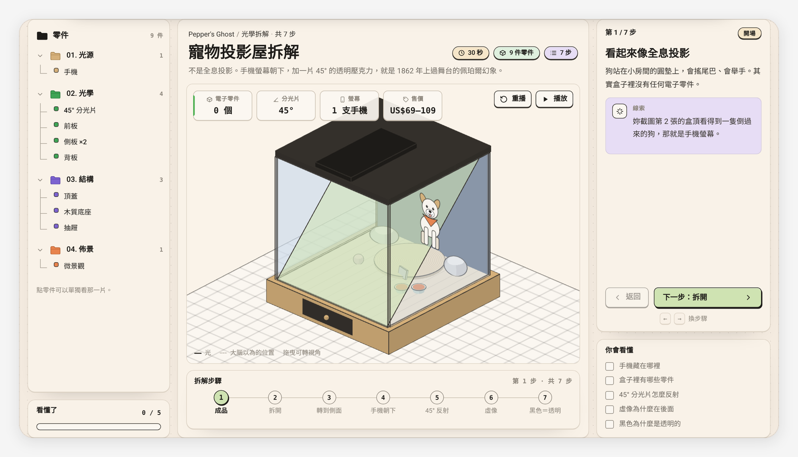
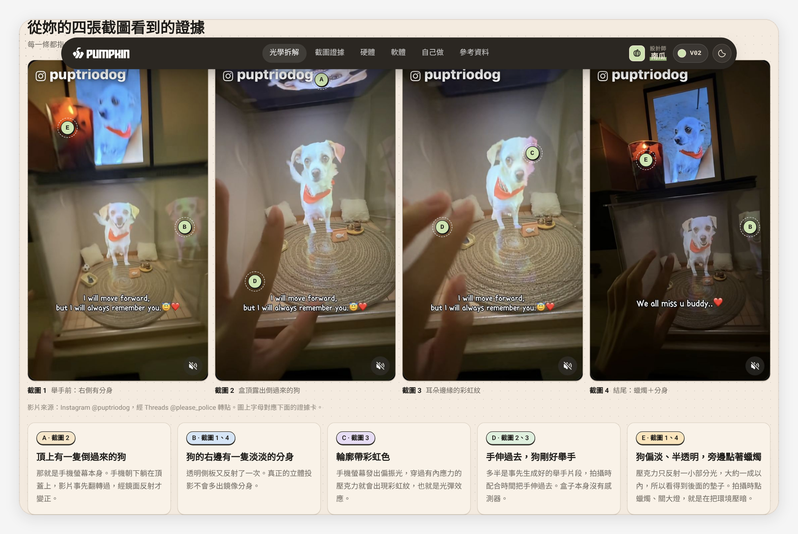
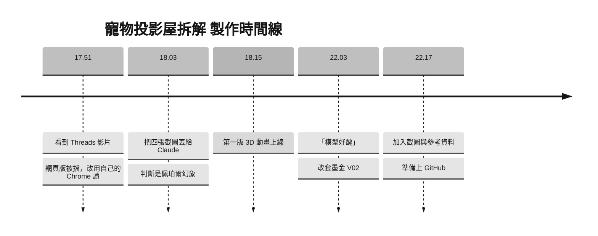
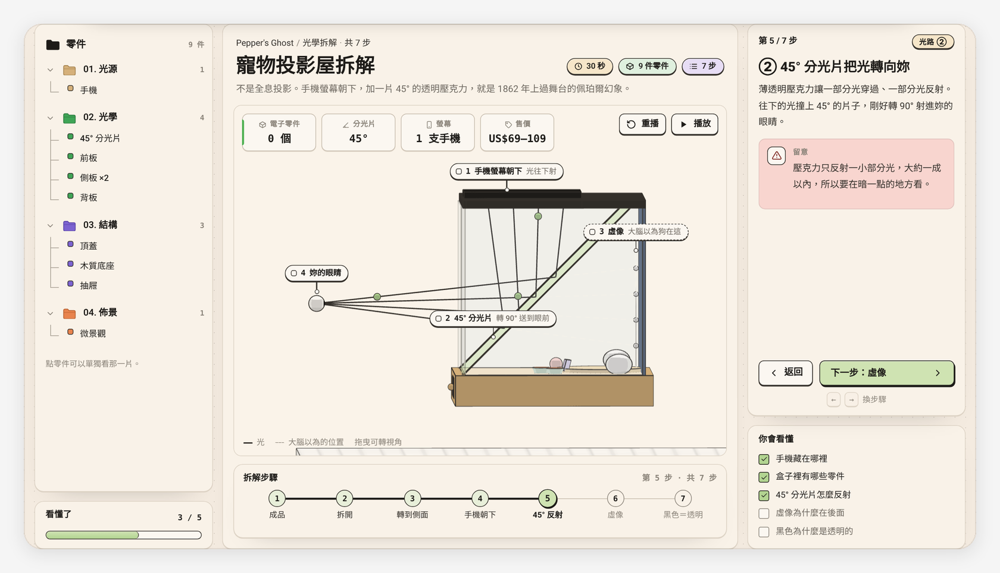
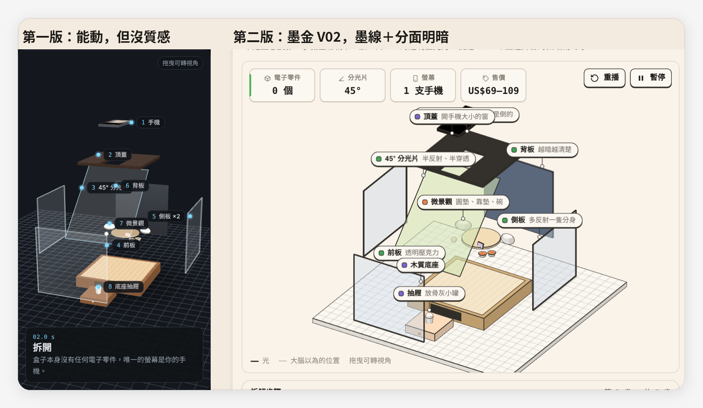
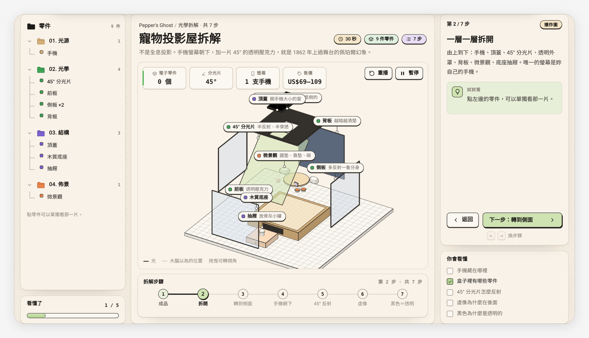

<picture>
  <source media="(prefers-color-scheme: dark)" srcset="../assets/banner-dark.svg">
  
</picture>

<h1 align="center">一支讓人哭的影片，我把它拆成 3D 動畫</h1>

<p align="center"><b>從 Threads 截圖到公開網站，一個晚上的製作紀錄</b></p>

<p align="center">
  
  
  
</p>

晚上五點多，Threads 滑到一支 22 萬次瀏覽的影片：小木盒裡站著一隻過世的狗，會搖尾巴、會舉手。留言區三百多則，幾乎都是「我不行😭」，也有人問哪裡買得到。

我好奇的是另一件事：**它到底怎麼做的？** 這篇記錄我跟 Claude 怎麼從四張截圖推出原理，做成一個能拆、能轉、能切剖面的 3D 網頁，中間撞到哪些牆。

> [!NOTE]
> **太長不看版**：這個「全息投影屋」其實是 1862 年的舞台魔術佩珀爾幻象，盒子裡沒有電子零件，只有朝下的手機和一片 45° 壓克力。我用 Three.js 做了 30 秒的爆炸圖動畫說明原理，第一版很醜，套上南瓜墨金 V02 之後才有質感。最難的不是 3D，是讓光路和物理對得上。

<p align="center"><br><sub>▲ 最後的成品</sub></p>

## 📌 目錄

- [起因：先看懂它在騙什麼](#起因先看懂它在騙什麼)
- [過程：一個晚上的時間線](#過程一個晚上的時間線)
- [踩到的坑](#踩到的坑)
- [學到的三件事](#學到的三件事)
- [如果你也想試](#如果你也想試)

---

## 起因：先看懂它在騙什麼

影片裡那個盒子，商品名叫「寵物全息投影屋」。聽起來很高科技，但截圖裡有幾個地方怪怪的。

最明顯的是第二張截圖：**盒頂露出一隻上下顛倒的狗。** 真的全息投影不需要在頂上放一個倒過來的畫面，這比較像有一面螢幕朝下。再看狗的右邊，還有一隻淡淡的分身，像是被玻璃多反射了一次。

<p align="center"></p>

把這些線索湊起來，答案就出來了：手機螢幕朝下放在盒頂，中間一片斜 45° 的透明壓克力，把畫面反射到觀眾眼前。這叫佩珀爾幻象（Pepper's Ghost），劇場和主題樂園用了一百多年。查到的商品拆解文章也證實了：45° 透明面、手機當光源、木底座加壓克力盒。

> 比喻：晚上從亮著燈的房間看窗戶，玻璃上同時看得到窗外的街景和房間裡的你。投影屋把「你」換成手機上的狗。

文字講得通，但「光從上面下來、轉個彎進眼睛、大腦以為狗在後面」這件事，用講的很難懂。所以我決定把它做成動畫。

---

## 過程：一個晚上的時間線



### 1. 先讓光路是算出來的，不是擺出來的

我最在意的是：動畫裡的光線位置要跟物理對得上。如果光線只是隨手畫幾條，懂的人一看就知道是假的。

所以模型裡的分光片是一個真的平面（`y + z = 12`），手機螢幕在它正上方。每條光線都是先決定「大腦以為狗在哪裡」，再用平面鏡公式反推手機上哪個像素發出這道光、在分光片哪裡轉彎。

<p align="center"></p>

算完才發現一件有趣的事：**狗一定會站在盒子的後段。** 虛像到分光片的距離等於手機到分光片的距離，手機在頂上，虛像就會被推到背板前面。這也解釋了為什麼實際商品的佈景都往後擺。

### 2. 一條時間軸管所有東西

參考的是一支 Mac 40 年一鏡到底的拆解影片，它的做法是「整個鏡頭由一條時間線驅動」。我照這個想法，用一個 30 秒的時鐘同時控制：

| 誰在動 | 跟著時間軸做什麼 |
|---|---|
| 零件 | 2–6 秒依序往外飛，每個晚一點，比同時分開好讀 |
| 鏡頭 | 等角 → 環繞 → 側面剖面 → 正面 |
| 光線 | 15.5 秒出現，光點沿著路徑跑 |
| 標籤 | 爆炸圖時標零件，剖面時標光路 |
| 步驟條 | 自動跟著亮到第幾步 |

好處是任何一格都能重現：點第 5 步，所有東西都會回到 18.2 秒該有的樣子。

### 3. 第一版能動，但很醜

第一版上線後，我自己看了只有一句話：「表演得很好，但模型好醜，完全沒有質感。」

<p align="center"></p>

問題出在我用了「預設 3D」的畫法：深色背景、打光、半透明發光。看起來像任何一個 Three.js 範例。

### 4. 套上墨金 V02

我有自己的設計系統「南瓜墨金美學」，1.9 版剛好新增了 V02 綠意紙本版，也有一份 3D 規則。叫 Claude 照著改：

| 部分 | 第一版 | 第二版（墨金 §11） |
|---|---|---|
| 背景 | 深藍黑 | 暖米紙 `#f4ebe0` |
| 鏡頭 | 透視鏡頭 | 正交鏡頭，像等角圖 |
| 明暗 | 打光 | 頂面本色，正面疊墨 12%、側面 20%、底面 26% |
| 輪廓 | 細白線 | 1.4px 墨線，圓的東西用反向外殼描邊 |
| 重點色 | 到處都是青色 | 只有分光片用嫩綠，因為它是主角 |
| 介面 | 自己刻的按鈕 | 墨金的資料夾樹、數值卡、步驟條、提示框 |

<p align="center"></p>

改完最大的差別不是好看，是**讀得懂**。墨線讓每個零件的邊界清楚，分面明暗讓立體感不靠打光，標籤用貼紙樣式，跟左邊零件樹的顏色對得上。

所有 3D 的顏色都從 CSS 變數讀，所以按右上角切換 V01／V02、深淺色，3D 也會跟著換。

<details>
<summary><b>🔧 給工程師：明暗 shader 長怎樣</b></summary>

不打光，直接看世界座標的法線決定要疊多少墨：

```glsl
vec3 n = normalize(vN);
if (!gl_FrontFacing) n = -n;
float k;
if (n.y > 0.55)       k = 0.0;   // 頂面：本色
else if (n.y < -0.55) k = 0.26;  // 底面
else k = abs(n.z) >= abs(n.x) ? 0.12 : 0.20;  // 正面／側面
vec3 c = mix(uColor, uInk, k);
```

圓的物件（靠墊、球、骨灰罐）會被切成幾個色帶，剛好有手繪感。輪廓用 `LineSegments2` 畫粗線，圓的東西再加一層「法線往外推、只畫背面」的墨色外殼。
</details>

### 5. 把截圖放回去

最後我把四張截圖和參考資料都放上去。截圖上標了 A 到 E 五個字母，對應下面的證據卡，讀者可以自己對照。

---

## 踩到的坑

> [!WARNING]
> 最大的坑：照物理做，狗會浮在半空。佈景要照光學反推回去擺，不能先擺好佈景再塞狗。

| 坑 | 當時怎麼發現 | 後來怎麼解 |
|---|---|---|
| Threads、X 的網頁都擋自動讀取 | 抓網頁直接被拒 | Threads 改用自己登入的 Chrome 開；X 讀不到，就照貼過來的文字描述做 |
| 狗浮在墊子上方 | 第一版算出來的虛像腳底離地 2 公分 | 讓影片裡狗的腳貼齊畫面靠前那端，墊子往後擺 |
| 淺色背景上，發光材質會糊掉 | 改成米紙底後，狗變成一團白 | 狗改成墨線插畫，透明底；手機上另外畫黑底版 |
| 爆炸圖鏡頭繞一圈會經過正面 | 環繞到一半，整個畫面變成平的 | 環繞角度縮小，維持在右前方 |
| 骨灰罐從地板戳出來 | 組好時罐子頂部高過底座 | 抽屜拉出來一半以上才顯示罐子 |
| GitHub 帳號連錯 | 推送時才發現連的是另一個帳號 | 重新授權正確的帳號 |

---

## 學到的三件事

1. **能算的就不要擺**：光線用公式算，不只看起來對，還意外解釋了「為什麼佈景都在後面」。
2. **質感來自規則，不是特效**：第一版加再多發光都不會變好看；套上一套有限制的設計規則（三種墨色深淺、一個重點色）反而一次到位。
3. **一條時間軸最好維護**：所有動畫都看同一個時鐘，要改節奏只動一個數字，點任何一步也能精準重現。

---

## 如果你也想試

想做類似的「原理拆解動畫」，跟 AI 要的時候講清楚這幾件事會快很多：

- **用哪個設計系統**：有自己的就指名，沒有就說「等角、墨線、不打光」
- **要哪幾段表演**：例如「爆炸圖每層晚 60ms 分開、停 2 秒」「剖面時外罩淡到兩成」
- **物理要算還是可以擺**：要算的話，給它關鍵的平面或公式
- **一條時間軸**：說清楚總長幾秒、每段在第幾秒

網站原始碼就在這個 repo 的 [`index.html`](../index.html)，整個網站一個檔案，可以直接拿去改。

還沒做的：手機版的爆炸圖標籤有點擠，之後想改成手機只顯示編號、點了才展開。有想法或發現哪裡講錯，歡迎開 Issue。

<sub>— 南瓜｜南瓜虛擬科技 · XR／3D／AI 工作流 · 最後更新 2026-11-19</sub>
